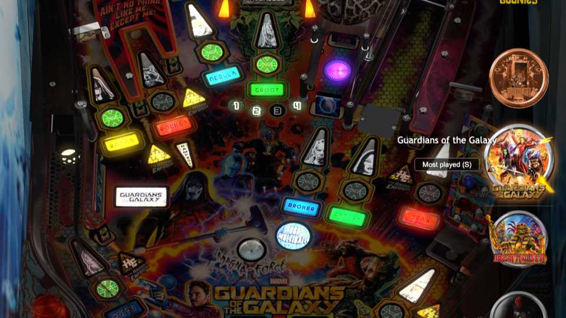

# Quick Spin

Quick Spin is an image-first cabinet theme for VPinFE, forked from
[Trifecta](https://github.com/emb417/vpinfe-theme-trifecta) 1.6.1 by emb417.
Trifecta's modular theme architecture and substantial original code remain in
this derivative.



## Overview

Quick Spin shows a seven-logo wheel over still playfield artwork, with a
matching backglass preview while browsing. It prioritizes quick scrolling and
can order games by play count or name. A custom PNG, JPG, WebP, or animated GIF
can replace the loading indicator; the image can be rotated to suit the cabinet.
The wheel can run vertically down the right side or horizontally across the
bottom of the playfield. The package includes no personal loading artwork.

## Why Quick Spin exists

Quick Spin was created for a virtual pinball cabinet built with older hardware
and limited memory, CPU, and GPU capacity. The goal was to preserve the familiar
look and cabinet-friendly layout of Trifecta while reducing the frontend work
needed to browse tables on a rotated playfield. It favors still preview images,
a simple wheel, and restrained transitions so navigation remains responsive on
less powerful systems. It may also be useful to anyone who prefers a lighter,
image-first frontend.

## What it does

- Shows a persistent seven-logo wheel that responds immediately to navigation.
- Uses still playfield and backglass images during browsing to reduce decoding work.
- Sorts by most-played count, with an A–Z toggle using both cabinet flippers,
  a configurable keyboard or gamepad button, or the on-screen button.
- Automatically advances through tables when left idle.
- Offers a vertical wheel at the player's right edge or a horizontal wheel
  across the bottom of the playfield.
- Uses a plain loading indicator by default, with an optional custom image.
  No personal loading artwork or playable table files are bundled. The theme
  preview is a screenshot of the Guardians of the Galaxy carousel.

## Wheel layout

Open Quick Spin's Configure screen in the VPinFE Manager, then set **Wheel
layout** to either **Vertical side wheel** or **Horizontal bottom wheel**.
Restart VPinFE after changing the setting. Vertical is the default so existing
Quick Spin installations keep their current layout.

Horizontal mode centers the table title, manufacturer, year, and sort control
beneath the selected wheel image instead of placing them at the end of the
carousel.

## Sort controls

By default, press both VPinFE browsing flippers together to switch between
**Most played** and **A–Z**. A single flipper press still moves the wheel
immediately. The default keyboard shortcut is **S**.

Quick Spin's Configure screen provides three related options:

- **Sort keyboard key** accepts a browser key or code such as `s`, `F8`, or
  `KeyS`. Leave it blank to disable the keyboard shortcut.
- **Sort with both flippers** enables or disables the cabinet chord.
- **Sort gamepad button** accepts a browser Gamepad API button index for a
  dedicated sort button. Use a spare button that is not assigned another
  VPinFE action; leave it blank to disable it. VPinFE's gamepad diagnostic can
  identify the correct index, which may differ from a VPX/SDL button number.

Restart VPinFE after changing these settings.

If the playfield panel is physically mounted sideways while VPinFE reports a
landscape screen with rotation 0, leave **Playfield mounting rotation** on
**Automatic (sideways cabinet)**. Quick Spin then maps the wheel to the physical
edge and counter-rotates its logos and labels. Select **Normal** for an
unrotated panel, or choose an explicit quarter-turn when automatic placement
does not match the cabinet.

## Custom loading image

1. Copy your image into this theme's `img/` directory. Create the directory if
   it does not exist. Keep the filename simple, such as `my-loading.gif`.
2. Set `loading_image` in `theme.json` to that **filename only**, without `img/`.
   Set `loading_rotation` to `0`, `90`, `180`, or `270` degrees if the image
   needs turning. The labels in VPinFE's Configure screen spell out clockwise
   and counterclockwise directions.
   When Quick Spin is published in the VPinFE theme registry, the same option
   can be edited through the theme's Configure button in the browser Manager.
3. Restart VPinFE. Leave the value blank to use the default loading screen.

For a local theme that does not yet have a Configure card in the Manager's
Themes catalog, the included SSH helper makes rotation easy:

```sh
cd ~/.config/vpinfe/themes/'Quick Spin'
python3 configure-loading.py --file ~/Downloads/my-loading.gif --rotate 90
python3 configure-loading.py --rotate 270
python3 configure-loading.py --clear
```

`90` means clockwise and `270` means counterclockwise. The helper checks image
format, dimensions and size before copying it into `img/`. The helper uses
Pillow; the running theme has no Pillow dependency. The distributed Quick Spin
package contains no personal image.

Accepted formats are PNG, JPG, WebP and GIF. The browser rejects files over
3 MiB, files wider or taller than 1920 pixels, and files above 2.1 million
pixels total. It checks the file signature as well as the extension. The image
is displayed within 82% of the screen width and 60% of its height, with a
1280-by-900 pixel display cap after rotation and without stretching. If the file is missing
or fails a check, Quick Spin keeps the default loading screen. Smaller GIFs
are preferable because animation still takes CPU time while a table loads.

## Status

Early release. Quick Spin has been run on one Linux two-display cabinet.
Display rotation and wheel placement are tuned first for a sideways-mounted
playfield with a landscape framebuffer. Both wheel layouts should also map to
their physical orientation on an unrotated display, but other cabinet layouts
need configuration feedback. Keep the original theme available as a fallback.

Quick Spin intentionally remains a VPinFE Contract 1 theme. It uses the launch
lifecycle and APIs shared by VPinFE 2.6 and the 3.0 compatibility layer, so the
same release can support current 2.x cabinets and a later 3.0 upgrade. Version
0.3.1 has been checked statically against the 3.0 Contract 1 documentation but
has not been run on VPinFE 3.0 beta; the cabinet remains on its current release.

## Files and installation

The theme files live at the repository root. To test a local copy, place the
directory under `~/.config/vpinfe/themes/Quick Spin/` and select **Quick Spin**
in VPinFE. The theme name, version, supported screens, and preview are defined
in `manifest.json`. VPinFE's publishing guide describes repository and registry
requirements: https://github.com/vpinfe/vpinfe/blob/master/docs/theme_publishing.md

## Upstream credit

Based on Trifecta by emb417: https://github.com/emb417/vpinfe-theme-trifecta

Quick Spin has no license file, matching the current Trifecta repository. A
GitHub fork preserves the upstream relationship and attribution. emb417 has
approved distributing Quick Spin through the VPinFE theme registry. Public
GitHub availability and registry installation do not grant additional reuse or
redistribution rights beyond those permissions.
