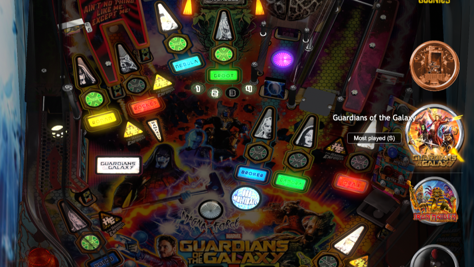

# Quick Spin

Quick Spin is an image-first cabinet theme for VPinFE, forked from
[Trifecta](https://github.com/emb417/vpinfe-theme-trifecta) 1.6.1 by emb417.
Trifecta's modular theme architecture and substantial original code remain in
this derivative.



## Overview

Quick Spin shows a seven-logo wheel over still playfield artwork, with a
matching backglass preview while browsing. It prioritizes quick scrolling and
can order games by play count or name. A custom PNG, JPG, WebP, or animated GIF
can replace the loading indicator; the image can be rotated to suit the cabinet.
The package includes no personal loading artwork.

## What it does

- Shows a persistent seven-logo wheel that responds immediately to navigation.
- Uses still playfield and backglass images during browsing to reduce decoding work.
- Sorts by most-played count, with an A–Z toggle using **S** or the on-screen button.
- Automatically advances through tables when left idle.
- Keeps the wheel and table details at the player's right edge on the cabinet
  layout used for initial development.
- Uses a plain loading indicator by default, with an optional custom image.
  No personal loading artwork or playable table files are bundled. The theme
  preview is a screenshot of the Guardians of the Galaxy carousel.

## Custom loading image

1. Copy your image into this theme's `img/` directory. Create the directory if
   it does not exist. Keep the filename simple, such as `my-loading.gif`.
2. Set `loading_image` in `theme.json` to that **filename only**, without `img/`.
   Set `loading_rotation` to `0`, `90`, `180`, or `270` degrees if the image
   needs turning. The labels in VPinFE's Configure screen spell out clockwise
   and counterclockwise directions.
   When Quick Spin is published in the VPinFE theme registry, the same option
   can be edited through the theme's Configure button in the browser Manager.
3. Restart VPinFE. Leave the value blank to use the default loading screen.

For a local theme that does not yet have a Configure card in the Manager's
Themes catalog, the included SSH helper makes rotation easy:

```sh
cd ~/.config/vpinfe/themes/'Quick Spin'
python3 configure-loading.py --file ~/Downloads/my-loading.gif --rotate 90
python3 configure-loading.py --rotate 270
python3 configure-loading.py --clear
```

`90` means clockwise and `270` means counterclockwise. The helper checks image
format, dimensions and size before copying it into `img/`. The helper uses
Pillow; the running theme has no Pillow dependency. The distributed Quick Spin
package contains no personal image.

Accepted formats are PNG, JPG, WebP and GIF. The browser rejects files over
3 MiB, files wider or taller than 1920 pixels, and files above 2.1 million
pixels total. It checks the file signature as well as the extension. The image
is displayed within 82% of the screen width and 60% of its height, with a
1280-by-900 pixel display cap after rotation and without stretching. If the file is missing
or fails a check, Quick Spin keeps the default loading screen. Smaller GIFs
are preferable because animation still takes CPU time while a table loads.

## Status

Development release. Quick Spin has been run on one Linux two-display cabinet.
Display rotation and wheel placement are currently tuned for a sideways-mounted
playfield with a landscape framebuffer. Other cabinet layouts need testing and
configuration options before a registry submission. Keep the original theme
available as a fallback.

## Files and installation

The theme files live at the repository root. To test a local copy, place the
directory under `~/.config/vpinfe/themes/Quick Spin/` and select **Quick Spin**
in VPinFE. The theme name, version, supported screens, and preview are defined
in `manifest.json`. VPinFE's publishing guide describes repository and registry
requirements: https://github.com/vpinfe/vpinfe/blob/master/docs/theme_publishing.md

## Upstream credit

Based on Trifecta by emb417: https://github.com/emb417/vpinfe-theme-trifecta

Quick Spin has no license file, matching the current Trifecta repository. A
GitHub fork preserves the upstream relationship and attribution. Public GitHub
availability allows viewing and forking through GitHub; it does not grant
general reuse and redistribution rights. Before requesting a VPinFE registry
listing that distributes installable copies, clarify those terms with emb417.
